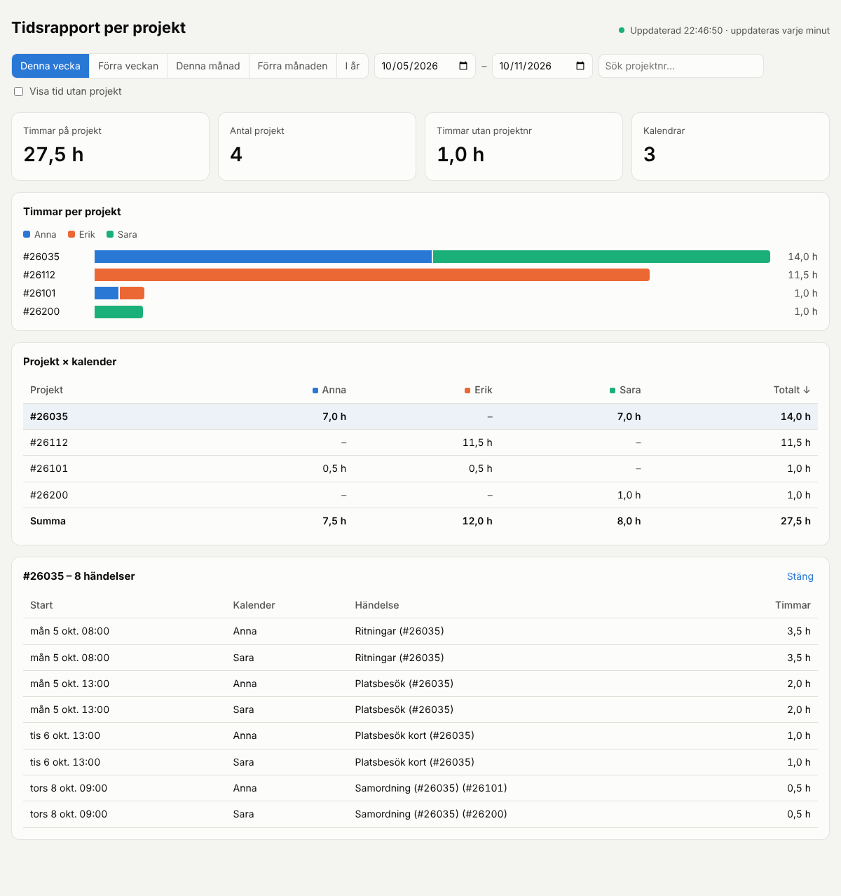

# Tidsrapport per projekt

Live-dashboard som läser era iCal-kalendrar och summerar hur många timmar
varje kalender har lagt på olika projekt. Projektnumret skrivs i parentes i
händelsens titel, t.ex. `Ritningar (#26035)`.



## Kom igång

```bash
npm install
cp calendars.example.json calendars.json   # fyll i era kalenderlänkar
npm start                                    # http://localhost:3000
```

### Kalenderlänkar från iCloud / Kalender-appen

1. Högerklicka på kalendern i Kalender (Mac) → **Dela kalender…** → bocka i
   **Offentlig kalender** (eller i iCloud.com: dela-ikonen → *Offentlig kalender*).
2. Kopiera länken (`webcal://p…-caldav.icloud.com/published/2/…`) och lägg
   in den i `calendars.json` med ett namn:

```json
[
  { "name": "Anna", "url": "webcal://p01-caldav.icloud.com/published/2/..." },
  { "name": "Erik", "url": "webcal://p02-caldav.icloud.com/published/2/..." }
]
```

Fungerar med alla `.ics`-länkar (Google Kalender: *Hemlig adress i iCal-format*,
Outlook: *Publicera kalender → ICS*). `calendars.json` är git-ignorerad eftersom
länkarna ger läsrätt till kalendern.

## Så räknas timmarna

- Alla `(#nummer)` i titeln räknas. En händelse med flera projektnummer delas
  lika mellan projekten.
- Återkommande händelser expanderas, inklusive ändrade och borttagna tillfällen.
- Heldagshändelser och inställda händelser räknas inte.
- Händelser som går över periodens gräns räknas bara med den del som ligger i perioden.
- Händelser utan projektnummer visas som *Utan projekt* (kryssruta i dashboarden).
- Klicka på ett projekt för att se de enskilda händelserna.

Dashboarden hämtar om data varje minut; servern cachar varje kalender i
`CACHE_SECONDS` sekunder. Notera att iCloud själv kan dröja några minuter
innan ändringar syns i den publicerade länken.

## Inställningar (miljövariabler)

| Variabel | Standard | Beskrivning |
|---|---|---|
| `PORT` | `3000` | Port för webbservern |
| `CALENDARS_JSON` | – | Kalenderlistan som JSON, i stället för `calendars.json` (praktiskt vid hosting) |
| `CACHE_SECONDS` | `60` | Hur länge en hämtad kalender återanvänds |
| `TZ` | `Europe/Stockholm` | Tidszon för vecko-/månadsgränser och visade tider |
| `DASHBOARD_PASSWORD` | – | Slår på lösenordsskydd (Basic Auth). Rekommenderas om sidan ligger publikt |
| `DASHBOARD_USER` | `admin` | Användarnamn för lösenordsskyddet |

## API

`GET /api/report?from=2026-10-05&to=2026-10-11` (båda datumen inklusive) ger
timmar per projekt och kalender, alla händelser samt eventuella fel per kalender.

## Test

```bash
npm test
```
